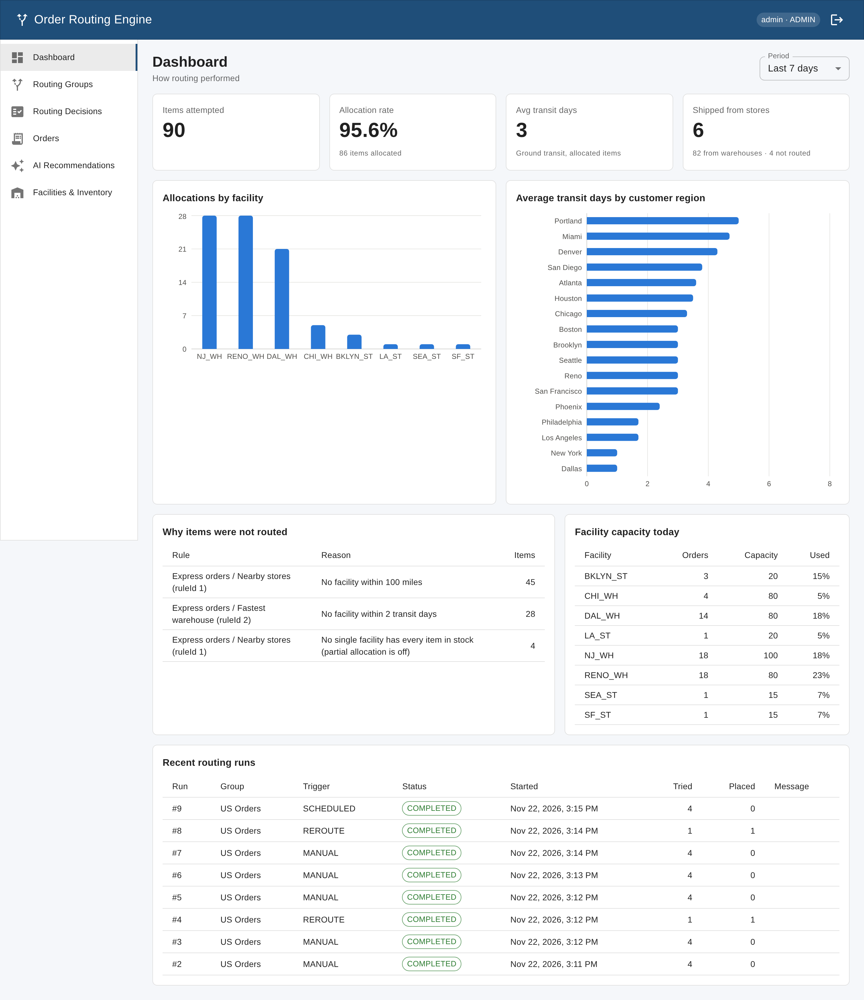
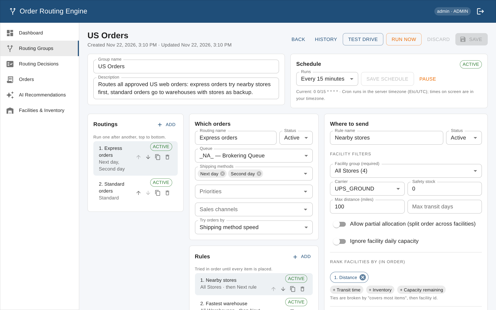
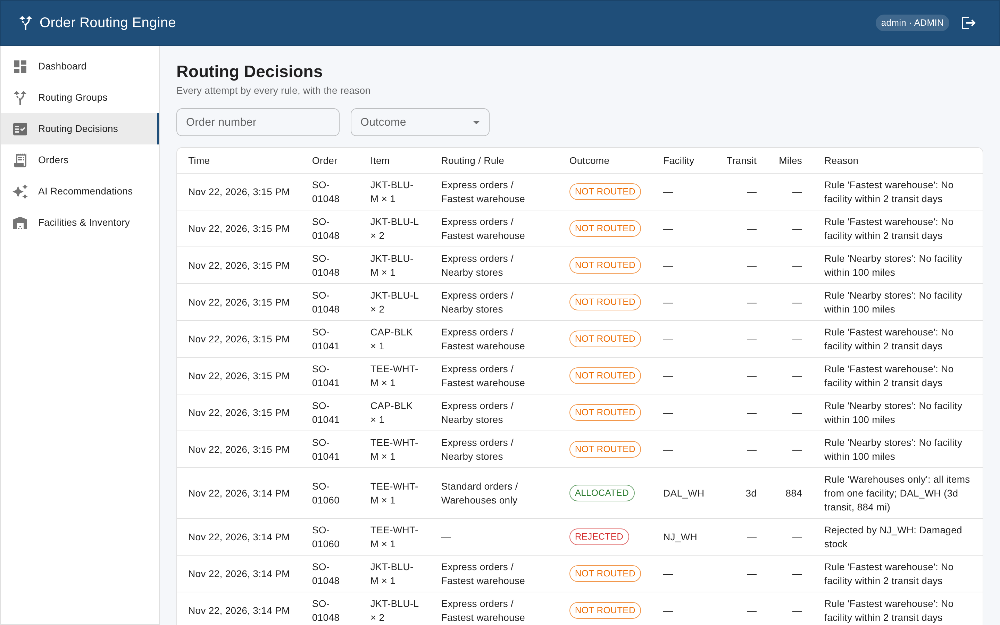

# Order Routing Engine

An order routing service that picks the **best fulfillment facility** (warehouse or store) for every order. It checks stock and capacity constraints, ranks the eligible facilities by **carrier ground transit time** between postal codes, and reserves inventory with **optimistic locking** so nothing is oversold. When a facility can't fulfill an item, the order is **re-routed automatically**.

An **agentic AI workflow** (an LLM with tool calling) analyzes routing results, inventory and customer locations, then recommends rule changes. Its output is schema-validated and is applied **only after an admin approves it** in the React dashboard.

**Tech:** Java 21 · Spring Boot 3.5 · Spring Data JPA (Hibernate) · MySQL · Spring Security + JWT · Spring AI (Anthropic) · React 19 + Vite · Material UI · Recharts · JUnit 5



---

## Features

| Area | What it does |
|---|---|
| **Routing engine** | Filters facilities on hard constraints (facility group, stock after safety stock, daily capacity, max distance, max transit days, brokering allowed, not previously rejected), ranks them by configurable sorts (transit time, distance, inventory, capacity), and places the whole order or splits it (partial allocation). Deterministic: ties break on items covered, then facility id. |
| **Overselling protection** | `@Version` optimistic locking on inventory, a stock re-check before each reservation, one transaction per order with automatic retry, and a database lock so only one routing run happens at a time. |
| **Automatic re-routing** | A facility rejects an item → reservation released → facility excluded for that item → order routed again right away. |
| **Routing configuration** | Routing groups → routings (*which orders*) → rules (*where to send them*). The whole group is saved atomically, with versioning to stop concurrent overwrites. |
| **Scheduling** | A separate cron schedule per group (registered at runtime), activate/pause, Run now, run history, stale-run recovery, and nightly cleanup. |
| **Test drive** | Runs the real engine on one order inside a transaction that is **always rolled back**, so you see exactly where the order would go without changing any data. |
| **Audit trail** | Every rule attempt is stored as a `RoutingDecision` (outcome, facility, transit days, distance, reason). |
| **AI recommendations** | Spring AI tool calling with 7 read-only tools, structured output, a 4-step validator, and admin approve/reject. Approval checks that the rules haven't changed since the AI read them. |
| **Dashboard (React)** | KPIs, allocations by facility, transit time by region, why items weren't routed, capacity, recent runs, plus pages for the group editor, decisions, orders, facilities and AI review. |
| **Security** | JWT auth. `ADMIN` can change things; `VIEWER` is read-only. |

## Architecture

```
React (Vite, MUI) ──/api──►  Spring Boot
                              ├── controller/     REST endpoints
                              ├── service/        config, execution, allocation, re-route, test drive
                              ├── engine/         RoutingEngine — pure Java, no DB (unit-tested)
                              ├── scheduler/      per-group cron jobs, maintenance jobs
                              ├── insights/       analytics for dashboard + AI tools
                              ├── ai/             Spring AI advisor, tools, validator, approval
                              ├── security/       JWT filter, roles
                              └── entity/ repository/   JPA (Hibernate creates the tables)
                                        │
                                      MySQL
```

### How an order is routed

```
Routing group (cron)
 └─ for each ACTIVE routing, in sequence      → picks WHICH orders (queue, shipping method, priority, channel)
     └─ for each matching order (own transaction, retried on lock conflict)
         └─ for each ACTIVE rule, in sequence  → decides WHERE
             1. FILTER  facilities: group, capacity, distance, transit days, stock − safety stock, brokering, exclusions
             2. RANK    by rule sorts → items covered → facility id
             3. PLACE   whole order from one facility, or split (partial allocation)
             4. RESERVE stock (optimistic lock) + count against daily capacity + save decision
             5. Unplaced items → next rule / move to queue / set auto-cancel date
```

### AI recommendation flow

```
Admin clicks "Get AI recommendations"
  → LLM gets the task + read-only tools (routing stats, unrouted reasons, inventory, capacity, demand by region, config)
  → LLM calls tools as it needs them (Spring AI runs the loop)
  → returns JSON → converted to AiRecommendationResponse (structured output)
  → validator: shape · rule belongs to group · oldValue = current value · newValue passes the same checks as a manual Save
  → saved as PENDING (or FAILED with the reason)
  → Admin approves → stale check → rules updated in one transaction → next run uses them
```

## Getting started

### Prerequisites
Java 21, Maven, Node 20+, and MySQL 8 (or Docker).

### 1. Start MySQL
```bash
docker compose up -d
```

### 2. Start the backend
```bash
cd backend
mvn spring-boot:run
```
On the first start, Hibernate creates the tables and sample data is loaded: 8 facilities, 3 facility groups, 6 products, inventory, 60 approved orders, a carrier transit table, and the "US Orders" routing group.

Environment variables (all optional):

| Variable | Default | Purpose |
|---|---|---|
| `DB_URL` / `DB_USERNAME` / `DB_PASSWORD` | `localhost:3306/order_routing`, `root` / `root` | MySQL connection |
| `JWT_SECRET` | dev-only value | JWT signing key (32+ characters) |
| `ANTHROPIC_API_KEY` | not set | Enables AI recommendations |
| `AI_MODEL` | `claude-sonnet-5-5` | Model used by Spring AI |

### 3. Start the frontend
```bash
cd frontend
npm install
npm run dev
```
Open http://localhost:5173 and log in with **admin / admin123** (can edit) or **viewer / viewer123** (read only).

### 4. Try it
1. **Routing Groups → US Orders → Test drive**: see where an order would go (nothing changes).
2. **Run now**: routes all waiting orders.
3. **Dashboard** and **Routing Decisions**: see where items went and why.
4. **Orders →** open an order **→ Facility rejects**: watch it re-route.
5. **AI Recommendations → Get AI recommendations** (needs `ANTHROPIC_API_KEY`) **→ Approve**.

### Deploy (Railway)
The root `Dockerfile` builds the React app and serves it from Spring Boot, so the whole app is **one service plus MySQL**. On Railway:
1. Add a MySQL database (template `mysql`).
2. Add a service from this GitHub repo; it builds with the root `Dockerfile`.
3. Set the service variables:
   - `DB_URL` = `jdbc:mysql://${{MySQL.MYSQLHOST}}:${{MySQL.MYSQLPORT}}/${{MySQL.MYSQLDATABASE}}?serverTimezone=UTC&allowPublicKeyRetrieval=true&useSSL=false`
   - `DB_USERNAME` = `${{MySQL.MYSQLUSER}}`
   - `DB_PASSWORD` = `${{MySQL.MYSQLPASSWORD}}`
   - `JWT_SECRET` = a random string of 32+ characters
   - `PORT` = `8080`
   - optionally `ANTHROPIC_API_KEY`
4. Generate a public domain. Every push to `main` redeploys.

### Run tests
```bash
cd backend
mvn test
```
There are 36 tests. Highlights: engine unit tests (pure Java), a concurrent-reservation test proving optimistic locking prevents overselling, an end-to-end routing run, re-routing, test drive rollback, the routing lock, and the AI validation/approval flow with the LLM mocked. Tests use an in-memory H2 database.

## REST API

All endpoints are under `/api`. GET needs any logged-in user; POST/PUT/DELETE need `ADMIN`.

| Method | Endpoint | Description |
|---|---|---|
| POST | `/auth/login` | Log in, returns a JWT |
| GET | `/auth/me` | Current user |
| GET | `/routing-groups` | List groups with schedule, next and last run |
| POST | `/routing-groups` | Create a group (DRAFT) |
| GET | `/routing-groups/{id}` | Group with its routings and rules |
| PUT | `/routing-groups/{id}` | Replace the whole group atomically (versioned) |
| DELETE | `/routing-groups/{id}` | Delete a group |
| PUT | `/routing-groups/{id}/schedule` | Set the cron expression (validated) |
| POST | `/routing-groups/{id}/activate` · `/pause` | Start or stop the schedule |
| POST | `/routing-groups/{id}/run` | Run now (routes real orders) |
| POST | `/routing-groups/{id}/test-drive` | Dry run for one order (`{orderId}`) |
| GET | `/routing-runs?groupId=` | Run history |
| GET | `/routing-decisions?orderNumber=&outcome=&ruleId=&runId=` | Audit trail |
| GET | `/orders?query=` · `/orders/{id}` · `/orders/{id}/decisions` | Orders and their routing history |
| POST | `/order-items/{id}/reject` | Facility rejects the item → automatic re-route |
| GET | `/facilities` · PUT `/facilities/{id}/capacity` | Facilities and daily capacity |
| GET/POST/PUT/DELETE | `/facility-groups[/{id}]` | Facility groups (delete is blocked while rules use the group) |
| GET | `/inventory?facilityId=` | Stock with available quantity |
| GET | `/dashboard?days=&groupId=` | Dashboard analytics |
| GET | `/meta` | Options for dropdowns, server timezone |
| GET | `/ai/status` | Whether AI is configured |
| POST | `/ai/recommendations/generate?groupId=` | Ask the AI for a recommendation |
| GET | `/ai/recommendations?status=` · `/{id}` | List or view recommendations |
| POST | `/ai/recommendations/{id}/approve` · `/reject` | Admin review |

## Screenshots

| Routing group editor | Routing decisions |
|---|---|
|  |  |

## Project phases

The project was built in phases; the commit history follows them.

1. **Foundation**: Spring Boot setup, entities, sample data, JWT security
2. **Routing configuration**: routing group APIs with atomic save and validation; facility, inventory and order APIs
3. **Routing engine**: pure engine with filters and ranking, inventory reservation with optimistic locking, execution with per-order transactions and an audit trail
4. **Operations**: routing lock, per-group cron scheduling, maintenance jobs, facility rejection with automatic re-routing, dry-run test drive
5. **AI recommendations**: insights service, Spring AI tools and advisor, validation and admin approval
6. **Frontend**: React app with dashboard, group editor, decisions, orders, facilities and AI review

## Design decisions

- **The engine is a pure function.** `RoutingEngine` takes plain records and returns a result. It has no JPA or Spring dependencies, so it's easy to unit-test, deterministic, and reusable for test drives.
- **Ordered sorts instead of weighted scores.** Ranking is explainable ("fastest transit, then most stock") and repeatable, and the AI can recommend sort changes the same way a person would.
- **One transaction per order.** One bad order never undoes the rest of a run, and optimistic lock conflicts are retried with fresh data.
- **The AI never writes.** Its tools are read-only and locked to one group. Every suggestion is validated with the same rules as a manual save and goes through human approval.
- **Single store.** For simplicity there is one product store. Multi-store support would add a `productStore` column to the main entities and an access check per request.
